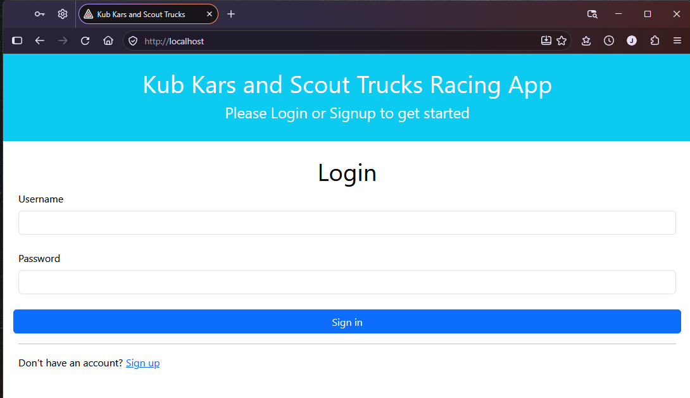
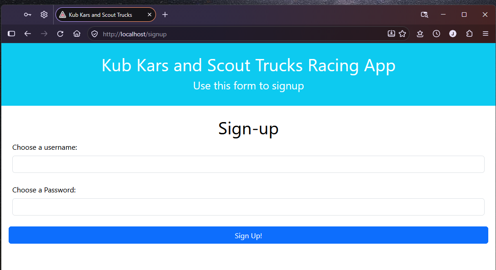
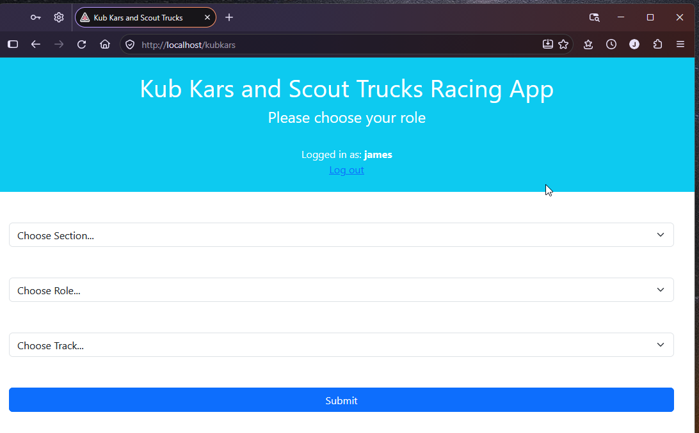
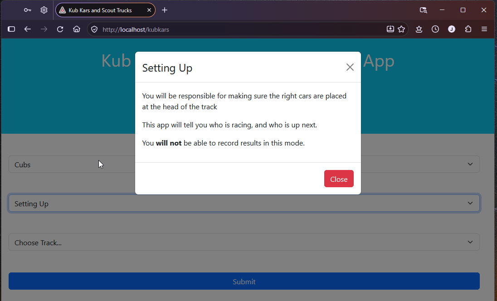
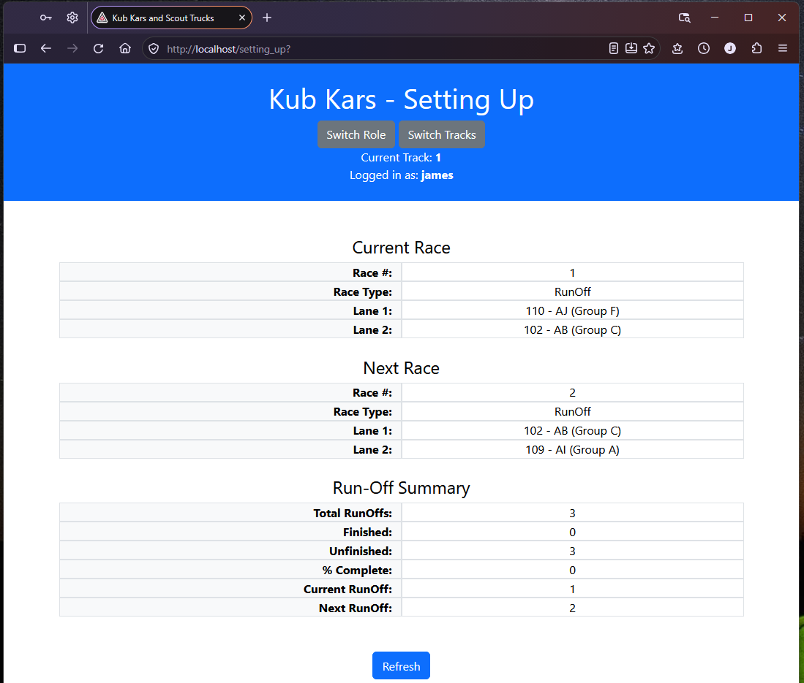
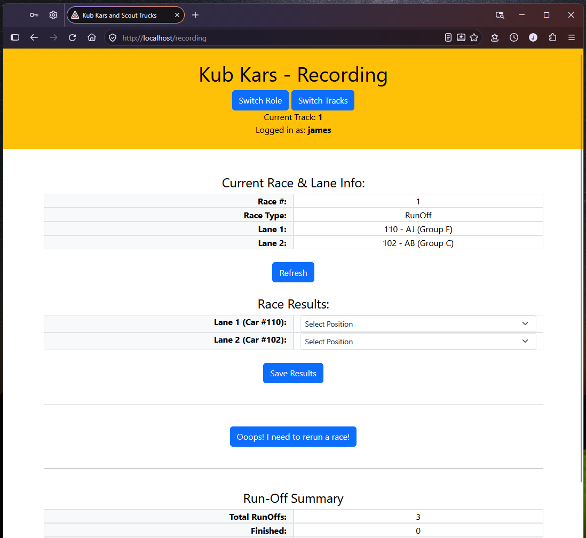
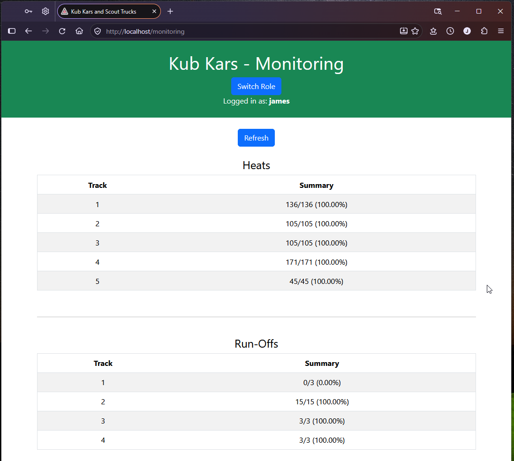
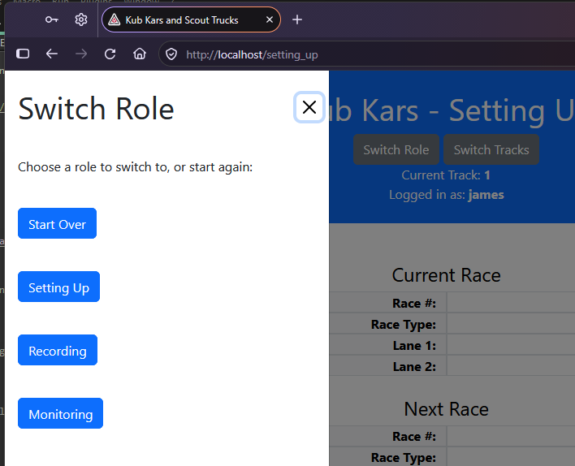
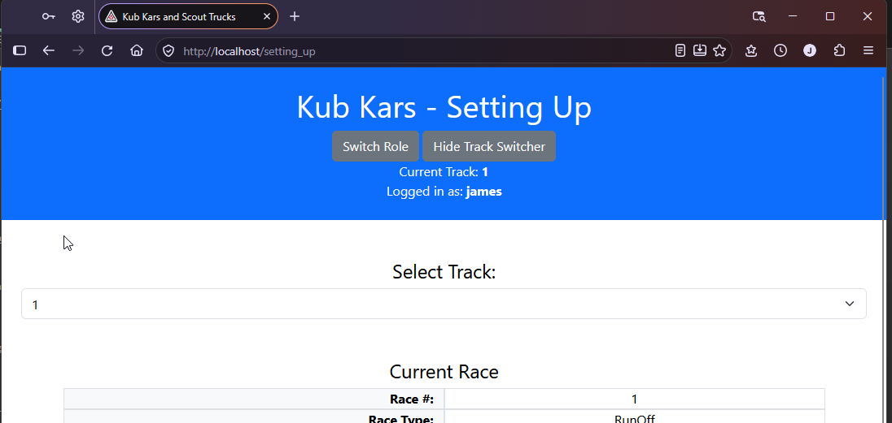

# kubkars

An app for recording results of races when running Kub Kars or Scout Trucks events.

NOTE: This app is NOT endorsed by Scouts Canada or anyone else; it is my own work.

This app came about because of a need for Scouters to be able to easily record the results of races when they are hosting races.

The app is intended to be hosted as an offline server, using a local wifi setup, with NO INTERNET. It is NOT intended to be online, open to the web; hence things like HTTP is probably OK.

The app requires a local Microsoft SQL Server be installed. Scripts are provided to create empty databases.

Data entry, setting up the tracks, entering the names of the racers, etc, is not covered here. That is handled by a separate app.


## Quick Start

To run this app, clone the repository and install dependencies:

```bash
$ git clone https://github.com/JamesProfitt/kubkars.git
$ cd kubkars
$ npm install
```

Then start the server.

```bash
$ npm start
```

Navigate to [`http://localhost`](http://localhost).


## Login

The first page that will greet you is the Login. Here you signup for an account. The accounts are held on the server hosting the app; there is no tie-in to any other system.



## Signup

Choose a new user/password when signing-up.

The password has some complexity requirements: Must be at least 8 characters long, and include: one uppercase, one lowercase, one number, one special character. Special Characters allowed are: 

```
(#?!@$%^&*-).
```



## Select Role

Select your role in the races.

1. Setting Up - Helping the kids place their cars on the track
2. Recording - Recording the results of the races
3. Monitoring - Checking how far along the races are, seeing if one track falls behind, etc.



## Setting Up

During setup, you are presented with the names of the Cubs/Scouts, what group they are from, and the number on their car. Use this to make sure the cubs get their car to where they need to be. 
There are two races presented: The current race, where cubs need to be putting their cars on the track ready for racing, and Next Race, where they need to be ready to move.




## Recording

As recorder, you will need to pay attention to each race, and record the results as they come in. Only ONE recorder per track should be recording, but you can have a backup. The app will refresh every 30s to keep everyone updated.



## Monitoring

A simple screen showing the progress across all Heats/Runoffs.



## Switching Roles

You can switch roles if you need, just press the Switch Roles button, and select a new role.




## Switching Tracks

Switching Tracks is also easy, just press the Switch Tracks button, and choose a new track from the selector.




